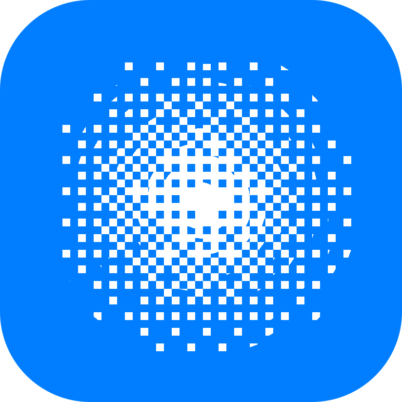

# Voidmesh

[voidmesh](https://voidmesh.xyz) is an infinite-canvas image/video filter tool built using WebGPU and React. It's a private, local application. Your data does not leave the browser, all computation is done locally on your device.

## Development

```sh
# install deps
bun i

# run development server
bun dev
```

## Production build

```sh
bun run build
```

## App icons

Every favicon, PWA, and Apple touch icon is rendered from `scripts/app-icons/logo.svg` (the desktop app icon):

```sh
bun run icons
```
